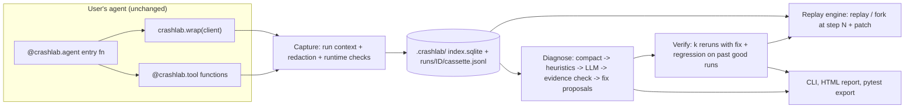

# crashlab architecture (v0.1)

**Crash-test your AI agents.** A local-first, framework-agnostic Python library that records an agent run, replays it exactly, diagnoses the failing step and its cause with verbatim evidence, verifies a proposed fix, and exports the failure as a pytest regression test.

Users keep their own agent loop. They only wrap their LLM client and decorate their tools.

## v0.1 scope (keep it tight)

- Providers: OpenAI and Anthropic clients (sync + async), LiteLLM via patch. No streaming replay beyond assembled responses.
- Failure labels (6 + UNKNOWN): `TOOL_ERROR_MISHANDLED`, `BAD_TOOL_ARGUMENTS`, `WRONG_TOOL_SELECTION`, `STEP_REPETITION`, `TASK_SPEC_VIOLATION`, `EXTERNAL_FAILURE`, `UNKNOWN`.
- Fault types for the seed benchmark (4): HTML/garbage tool result, persistent tool error, ambiguous tool descriptions, removed system-prompt constraint. Plus clean runs for false positives.
- Demo agents (2): `refund_bot` (order DB + refund tool + policy), `sql_analyst` (SQLite schema/query tools).
- Deferred: MCP proxy, LangGraph adapter, memory correction, auto-apply fixes, hosted version, web app.

## Data flow



## Modules (build in this order)

| # | Module | Responsibility |
|---|---|---|
| 1 | `models.py` | Pydantic v2: `Run`, `Step`, `Flag`, `Patch`, `Diagnosis`, `Evidence`, `Fix`, `Verification` |
| 2 | `context.py` | `contextvars` current run, monotonic step counter, mode (`record` / `replay` / `fork`) |
| 3 | `store/` | `sqlite.py` index (runs, steps metadata, flags, diagnoses), `cassette.py` JSONL read/write, `redact.py` strips keys/headers + user regex hook |
| 4 | `capture/` | `normalize.py` (provider -> common request/response shape + request hash), `openai.py`, `anthropic.py`, `litellm.py` proxies, `_chat.py` (single LLM-call interception point), `streams.py` (pass-through stream wrappers + assemblers), `tools.py` (`@tool(side_effects=...)`), `agent.py` (`@agent`, `record()` context manager); `integrations/litellm.py` exposes `patch()` / `unpatch()` |
| 5 | `cli.py` | Typer + Rich: `ls`, `show`, `replay`, `check`, `diagnose`, `fix`, `report`, `fork`, `diff`; later `verify`, `export-test`, `report`, `bench` |
| 6 | `replay/`, `patch.py`, `compare.py` | `engine.py` (strict replay; fork = cassette for steps < N, patch from N, live after), `patch.py` (typed patches: `SystemPrompt`, `Message`, `InjectMessage`, `ToolResult`, `ToolDescription`, `ToolSchema`, `ModelParams`), `divergence.py` (hash mismatch -> `DivergenceError` with diff), `compare.py` (run diff) |
| 7 | `checks/` | Inline findings (built, see below): `loop` (same tool+args >= 3 in last 8 steps), `tool_error_streak` (>= 3), `bad_tool_args`, `suspicious_tool_result` (HTML/empty where JSON expected), `budget`, `length_cutoff` |
| 8 | `diagnose/` | `compact.py` step table with truncation handles, `heuristics.py` candidate steps from flags/errors, `diagnoser.py` one LLM call returning JSON (failing_step, label, evidence, explanation, confidence), `evidence.py` drops quotes not found verbatim -> UNKNOWN if none, `fixes.py` separate LLM call producing 1-3 typed fixes, `taxonomy.py` enum + definitions |
| 9 | `verify/` | `runner.py` k forks with fix + reruns of past passing runs, `oracles.py` (`@check` fns > "same failure didn't recur" > LLM judge, labelled weaker), `stats.py` pass^k + Wilson CI + verdict |
| 10 | `export/` + `pytest_plugin.py` | Write `tests/crashlab/test_<agent>_<id>.py` + copied cassette; plugin adds `crashlab_replay` fixture and `--crashlab-live` |
| 11 | `report/` | Single-file HTML report (Jinja2): timeline, failing step, evidence, fix diff, verification table |
| 12 | `bench/` | Fault injectors, seed runs, metrics: step localization (exact / within window), label accuracy, fix success, false positive rate, cost |

## Capture details (as built)

- **Common shape.** Every provider maps to `{"system", "messages", "tools", "params"}` requests
  and `{"messages", "tool_calls", "finish_reason", "usage", ...}` responses. Messages carry
  typed `parts` (`text`, `tool_call`, `tool_call_response`, `image`/`audio`/`file`
  placeholders, `reasoning`), loosely following the OTel `gen_ai.input.messages` schema.
  Tool-call arguments are stored parsed (invalid JSON stays a raw string). Anthropic
  `tool_result` blocks become `tool` messages, so OpenAI and Anthropic runs line up.
- **Request hash.** sha256 of canonical JSON (sorted keys) of the redacted normalized
  request. Transport-only kwargs (headers, timeouts, `stream`, API keys) are excluded, so a
  streamed and a plain call with the same inputs hash the same.
- **One interception point.** All LLM calls go through `capture/_chat.invoke()`; replay
  will substitute cassette responses there.
- **Streaming.** Streams are wrapped, not consumed: chunks pass through unchanged and the
  assembled final response is recorded on end / error / close (`crashlab.stream.complete`).
- **OpenAI-compatible quirks.** `reasoning` / `reasoning_content` on assistant messages and
  stream deltas (Groq, DeepSeek, vLLM, LiteLLM) become `reasoning` parts. `finish_reason`
  `"stop"` on a turn that has tool calls (Gemini streams) normalizes to `"tool_calls"`; the raw
  value stays in `provider_finish_reason`. The provider's `total_tokens` is kept
  (`crashlab.usage.total_tokens`) and summed into the run total, because it can exceed
  input+output (Gemini thinking tokens).
- **Opaque tokens survive.** Media elision only touches `data:` URLs and base64 under media
  keys (`data`, `b64_json`, `file_data`...). Replay tokens such as Gemini `thought_signature`,
  Anthropic `signature` / `redacted_thinking`, and OpenAI `encrypted_content` are stored
  verbatim, since the provider needs them back.
- **Threads.** Context vars do not cross plain threads; `crashlab.bind_context`,
  `ContextThreadPoolExecutor` and `run_in_thread` carry the active run into workers.

## Replay and checks (as built)

- **Strict replay** (`replay/engine.py`). `crashlab.replay(run)` imports the recorded entry
  point, calls it with the recorded input (plus `overrides=`), and puts the new run in
  `mode="replay"` with a `Replayer` on the run context. There is no second code path: the
  capture points ask the replayer before doing anything live.
  - `capture/_chat.invoke()` (the single LLM interception point) never calls the SDK. It
    returns the recorded response rebuilt as the recorded class (`crashlab.response.type`,
    e.g. `ChatCompletion`, `anthropic` `Message`, `litellm.ModelResponse`; `ReplayObject`
    fallback). Streams become a synthetic stream rebuilt from the assembled response, and
    Anthropic `messages.stream()` yields the SDK's own `MessageStream` over synthetic events.
    Proxies pass `is_async` explicitly, since SDK async methods do not look like coroutines.
  - `@crashlab.tool` never runs the function in replay: it returns the recorded result or
    re-raises the recorded exception (same type name and message, so the next request is
    identical). `side_effects=True` tools are additionally guarded in non-record modes.
  - Recorded LLM errors are re-raised the same way (dynamic subclass of the original type,
    `status_code` kept).
- **Matching.** A call must be the next step by `idx` with the same operation and name, and
  its redacted normalized request must hash to the recorded `request_hash`. At run end the
  replayer also checks that no recorded step was skipped, that the output matches, and that
  the run raised the same exception (or none) as the recording.
- **DivergenceError** (`replay/divergence.py`) carries `kind` (`request`, `step`,
  `extra_step`, `missing_steps`, `output`, `exception`, `network`), `step_idx`, `fields`
  (dotted paths such as `system` or `args.order_id`) and a unified diff per differing
  field, rendered YAML-style so prompts diff line by line. It is sticky: user code that
  swallows it (`except Exception`) cannot hide it, and `replay()` re-raises at the end. The
  diverged replay is still stored (`status="error"`) for `crashlab show`.
- **Offline guards.** During replay outbound socket connections raise (and count as a
  `network` divergence), and unset `OPENAI_API_KEY` / `ANTHROPIC_API_KEY` get a placeholder
  so SDK clients can be constructed. Nothing is ever sent.
- **Provenance.** Replay runs get `replay_of` (indexed column, schema v2 with an automatic
  v1 migration) and the `replay` tag; served steps have `source="cassette"` and
  `crashlab.replay.source_step`.
- **Outcome oracles** (`verify/oracles.py`). `@crashlab.check("agent")` registers a function
  of the finished `Run`. Returning `True` / `None` passes; `False`, a non-empty message, or
  an `AssertionError` fails; any other exception is `error`. Checks run in `record.__exit__`
  (steps are kept in memory for this) and set `outcome` / `outcome_reason` unless the user
  set an outcome by hand. Results are stored in `run.checks`. `crashlab check` re-runs them.
- **Known limits.** Streamed calls replay with different chunk boundaries (same final
  content). Tool results come back as their recorded JSON (a tool that returned a dataclass
  replays a dict). Runs recorded with `crashlab.record(...)` need `replay(run, fn=main)`.
  Strict order means concurrently started tool calls must start in the recorded order.

## Fork, patches and diff (as built)

- **Fork** (`replay/engine.py`, `Forker`). `crashlab.fork(run, at_step=N, patch=..., client=...)`
  re-runs the recorded entry point (same path as replay) in `mode="fork"`. Steps `< N` must
  match the cassette exactly, as in strict replay (a mismatch is a `DivergenceError`). From
  `N` on, LLM calls go to the real SDK (or the `client=` / `fn=` you pass) and tools follow
  `tools="cassette_if_match"` (a call with the same tool and equal arguments as an unused
  parent call gets the recorded result; otherwise it runs) or `tools="live"`.
  `side_effects=True` tools never run live unless `allow_live_side_effects=True`: an
  identical parent call is served once, anything else raises `SideEffectBlockedError` and
  the step is stored with `source="blocked"` so checks still see the attempt. The network is
  not blocked. Agent exceptions after `N` are stored on the fork (`status="error"`), not
  raised, unless `raise_errors=True`. The fork is stored with `forked_from`, `fork_step`,
  `patch` and `patch_description`; flags note a fork point never reached or a patch never
  applied. `at_step` can be negative (from the end); patches bound to steps before `N` and
  patches that do not fit the recorded requests (unknown tool, no such message) fail with
  `ForkError` / `PatchError` before anything runs.
- **Patches** (`patch.py`). Pydantic models with a `kind` discriminator, combined in a
  `PatchSet` (`a + b`, JSON/YAML via `crashlab.patch.load(path)`). Request-wide patches
  (system prompt, tool description / schema, model params) apply to every LLM request with
  `idx >= max(N, from_step)`; step-bound ones (`MessagePatch`, `InjectMessagePatch`: sticky,
  so later requests that resend the history keep the edit; `ToolResultPatch`: replaces one
  tool step's result or raises a `PatchedToolError`) bind to a step. They edit the native
  SDK kwargs before the request is normalized and hashed, through one `RequestEditor` per
  API family (chat / LiteLLM, Anthropic with `system` string or blocks, Responses
  `instructions`); message indexes refer to the normalized `request.messages`. Patched
  steps get `source="patched"` and the `crashlab.fork.patches` attribute.
  `PatchSet.render_diff(run, N)` previews the change against the recorded requests.
- **Diff** (`compare.py`). `crashlab.diff(a, b)` -> `RunDiff`: relation (fork / replay /
  unrelated), outcome and per-check changes, usage deltas, and a per-step status (`same`,
  `request`, `response`, `different` call, `only_a`, `only_b`) comparing the normalized
  request and response with volatile fields (ids, signatures, usage) removed, plus the
  first divergence with a field diff.

## Runtime checks and cost (as built)

- **Findings** (`models.Finding`; `Flag` is an alias): `kind`, `severity` (`info` < `warn` <
  `error` < `critical`), `step` / `steps`, `message`, `evidence` (verbatim quotes with step
  and field), a merge `key` and `stopped_run`. Stored in `run.json` and indexed in the
  `flags` table; `runs.max_severity` and `runs.cost_usd` back `ls --flagged`. Runtime
  checks are separate from `@crashlab.check` oracles: findings say how a run behaved,
  oracles say whether it passed. A finding never changes the outcome, except a
  circuit-breaker stop.
- **Detectors** (`checks/detectors.py`) are small stateful objects with `on_step` and
  `on_end`. `checks/engine.py` `CheckEngine` runs them inline (`RunContext.add_step`) and
  `checks.evaluate(run, config)` runs the same code over a stored run. Findings with the
  same `(kind, key)` are merged: steps extend, severity only goes up, evidence is capped.
  `suspicious_tool_result` drift compares a result's shape (keys and JSON types) with
  earlier results of the same tool in the run and in the last 5 ok runs of the same agent
  (majority keys).
  Repetition after a failing result is `warn`, after differing results `info`, and
  `critical` at 5. HTML or error bodies count as tool failures for `tool_error_streak`.
- **Config** (`checks/config.py`, `ChecksConfig`): defaults < `[tool.crashlab.checks]` in
  the nearest `pyproject.toml` < `record(checks=...)` / `agent(checks=...)` (a dict or a
  `ChecksConfig`; `False` disables). The resolved config is stored in `run.check_config`, and
  replay / fork / `crashlab check` start from it, so a stored run keeps its limits.
  `CRASHLAB_NO_PYPROJECT=1` ignores pyproject.
- **Circuit breaker** (opt-in): a new critical finding raises `CircuitBreakerError`
  (a `BaseException`, so `except Exception` in agent code does not swallow it) right after
  the step is stored. For streams it is raised at the next step, so the stream itself
  completes. End-of-run findings never trip it. The finding gets `stopped_run=True`; the
  run ends with `status=error`, `outcome=fail`. A strict replay re-raises at the same step
  from the stored finding, and `crashlab check --save` keeps that marker. A fork uses the
  config as it is now.
- **Cost** (`pricing.py`): the provider comes from `server.address` (known API hosts; localhost
  / `*.local` = local = $0) or the LiteLLM model prefix. Prices come from custom
  (`set_price`, `[tool.crashlab.prices]`), then the built-in dated table (`PRICES_AS_OF`),
  then LiteLLM's bundled `model_cost` (never fetched). OpenAI-style input includes cached
  tokens; Anthropic cache reads and writes are separate. Total tokens beyond input + output
  (thinking) are billed as output. Unknown model or no usage reported means `None`, and one
  unknown call makes the run total `None`. Replayed steps keep the recorded cost.
- **Export / import** (`store.export_run` / `import_run`): one JSONL file, a
  `{"type": "crashlab.run"}` header line with the run, then the redacted cassette lines.
  The demo runs in `examples/refund_bot/demo/` are such files.

## Diagnosis (as built, v1)

`crashlab.diagnose(run, model=...)` / `crashlab diagnose RUN...` answers "which step went
wrong, and why" with one LLM call over a compacted trace, then checks the answer against
the trace.

1. **Candidates** (`heuristics.py`): cheap signals, strongest first: a failed LLM API call
   (rate limit, 5xx), runtime findings (`bad_tool_args`, `step_repetition` at its first
   repeat, `tool_error_streak`, `suspicious_tool_result`; schema drift counts as
   external), failed `@crashlab.check` oracles (the `step N` in their message), errors
   and blocked side effects. `heuristic_raw(run)` turns them into a rule-table diagnosis:
   the `--heuristic` baseline, no LLM.
2. **Compaction** (`compact.py`): task input, result, checks, findings and candidates as
   hints; the system prompt and tool signatures once; then per step only what is new (a
   chat step's new messages since the agent's previous turn, its reasoning, reply and
   tool calls; a tool step's args, result or error). Long fields are cut with
   `…[truncated: X is N chars; only the part above can be quoted]`. `hide_input` drops
   run input keys (the eval hides fault switches, model and provider).
3. **One call** (`diagnoser.py`, prompt `diagnose-v1`): JSON with `label`,
   `failing_step`, `root_cause`, `evidence[{step, quote}]`, `secondary`, `confidence`.
   Labels: `TOOL_ERROR_MISHANDLED`, `BAD_TOOL_ARGUMENTS`, `WRONG_TOOL_SELECTION`,
   `STEP_REPETITION`, `TASK_SPEC_VIOLATION`, `EXTERNAL_FAILURE`, `UNKNOWN`, plus the verdict
   `NO_FAILURE`. `response_format=json_object` is asked for and dropped if the server
   rejects it; bare, fenced or embedded JSON is accepted.
4. **Validation** (`evidence.py`): a quote is kept only if it appears verbatim in a field
   of the step it cites (after NFKC, plain quotes and dashes, whitespace collapsing and
   stripping leading / trailing ellipses; case-sensitive, at least 3 characters). A label
   outside the taxonomy, a missing or nonexistent step, or a failure label with no
   surviving quote becomes `UNKNOWN` (confidence capped at 0.2, the claimed label kept in
   `secondary`, the reason in `notes`). `NO_FAILURE` on a run whose outcome is `fail` also
   becomes `UNKNOWN`.
5. **Storage**: `Run.diagnosis` (shown by `crashlab show`, in `--json`) plus a history row
   in the `diagnoses` table (schema v4) keyed by `cache_key` = sha256(prompt version,
   model, messages): an unchanged run is not asked again; a changed trace, check or
   finding is. The diagnoser's own LLM calls are recorded as `crashlab-diagnoser` runs in
   `<store>/diagnoser/`, never among the user's runs, and `diagnose()` refuses to run
   inside an active run.
6. **Models**: `base_url=` (or `$CRASHLAB_DIAGNOSER_BASE_URL`) for any OpenAI-compatible
   endpoint (Groq, Gemini, Ollama, vLLM), LiteLLM model strings (`groq/`, `gemini/`,
   `ollama/` ...), `claude-*` via Anthropic, else OpenAI; `client=` for your own client,
   `fn=` for any callable (not recorded). The CLI takes `--api-key-env VAR`, never a key.

Culprit step convention (used by the prompt and the eval): the tool step that executed a
wrong action; if no tool ran, the chat step whose reply was wrong; for an external
failure the step where it shows; none for `NO_FAILURE`. `bench/diagnose_eval.py` scores
label and step accuracy on 31 hand-labelled live runs (`bench/diagnose_cases.json`).
Prompt v3 adds two rules learned from the Day 6 misses: a tool error / HTML page is
never `NO_FAILURE` (`EXTERNAL_FAILURE` if handled, `TOOL_ERROR_MISHANDLED` if not), and a
loop is blamed on its first repeat, not on the step where a budget check fails.

## Fix proposals and the report (as built)

`crashlab.propose_fixes(run_or_diagnosis, model=...)` / `crashlab fix RUN` (`fixes.py`,
prompt `fix-v1`) is a second LLM call, never merged with the diagnosis. Input: the
diagnosis (label, step, root cause, evidence) and the same compacted trace. Output:
`{"fixes": [{"patch": {...}, "rationale", "expected_effect", "literal_justification"?}]}`,
1-3 ranked. Each proposal is validated and kept as a `Fix` on `run.diagnosis.fixes`; every
rejection is a line in `diagnosis.fix_notes`:

1. it parses into a known patch type (system_prompt, tool_description, tool_schema,
   tool_result, model_params, message, inject_message);
2. its target exists: the tool is in the run's tool list, the step exists and has the
   right kind, and a dry run (`preview_patches`) against the recorded requests applies
   and changes something (anchors found, lines in range);
3. it is minimal: at most 700 characters of patch text, at most 4 new prompt lines, no
   `replace` / `prepend` of the whole system prompt;
4. leakage guard: literals of this task instance (ids and 2+ digit numbers from the run
   input and the tool arguments / results, minus those already in the system prompt or
   tool descriptions) must not appear in a request patch unless the proposal gives a
   `literal_justification` (kept with a note). `tool_result` patches are counterfactuals
   for testing a hypothesis: allowed, flagged `test_only`, never `--try`'d.

Kept fixes are saved as `<store>/runs/<id>/fixes/fix-N.yaml` (JSON without PyYAML) for
`crashlab fork --patch`, and cached by a hash of the fix prompt. `try_fix(run, fix)` /
`--try` forks once from the step the patch applies to (the first LLM call for request
patches) with the agent's own client and stores `fix.tried` (fork run id, outcome, failed
checks). Repeated verification (k reruns, regressions) is Day 8.

`crashlab report RUN` renders the run header, checks, findings, the diagnosis panel, the
fixes with their diffs, rejections and `--try` result, and next-command hints;
`crashlab diagnose --fix [--try]` prints the same report.

## Key design rules

1. Never record secrets. Redact before writing.
2. Tools marked `side_effects=True` never run live during replay or fork; they return the recorded result or a stub that raises.
3. Fixes are suggestions. Never auto-apply to user code.
4. Every diagnosis must cite verbatim evidence, or it says UNKNOWN.
5. Diagnosis and fix proposal are separate LLM calls.
6. Show estimated cost before verification; default k=3; early stop when the target fails twice.
7. Core installs with no provider SDKs; providers are extras (`crashlab[openai]`, `[anthropic]`, `[litellm]`).
8. No telemetry.

## Public API target

```python
import crashlab
from openai import OpenAI

client = crashlab.wrap(OpenAI())          # or anthropic.Anthropic(); LiteLLM: crashlab.integrations.litellm.patch()

@crashlab.tool()
def get_order(order_id: str) -> dict: ...

@crashlab.tool(side_effects=True)
def issue_refund(order_id: str, amount: float) -> dict: ...

@crashlab.agent(name="refund-bot")
def run_agent(user_msg: str) -> str: ...   # existing loop, unchanged

@crashlab.check("refund-bot")
def refund_not_above_total(run) -> bool: ...

run = crashlab.load("last")
crashlab.replay(run)                                    # offline, exact
b = crashlab.fork(run, at_step=2, patch=crashlab.SystemPromptPatch(op="append", text="..."))
crashlab.diff(run, b)                                   # checks, usage, step divergence
d = crashlab.diagnose(run)                              # failing_step, label, evidence, fixes
v = crashlab.verify(run, fix=d.fixes[0], k=3)           # verdict, pass^k, CI
crashlab.export_test(run, fix=d.fixes[0])
```

```bash
crashlab ls --flagged
crashlab diagnose last
crashlab verify last --fix 1 -k 3
crashlab export-test last --fix 1 && pytest tests/crashlab -q
crashlab report last --open
```

## Repo layout

```
src/crashlab/{__init__,models,context,cli,pytest_plugin}.py
src/crashlab/{store,capture,integrations,checks,replay,diagnose,verify,export,report}/
examples/{refund_bot,sql_analyst}/
bench/{faults.py,run_bench.py,results/}
tests/
.github/workflows/{ci.yml,release.yml}
pyproject.toml  LICENSE  README.md  ARCHITECTURE.md
```

## Stack

Python >= 3.10, Pydantic v2, stdlib sqlite3, Typer + Rich, Jinja2, hatchling, uv, ruff, pytest + pytest-asyncio, GitHub Actions (3.10 to 3.13), PyPI Trusted Publishing, Apache-2.0.
