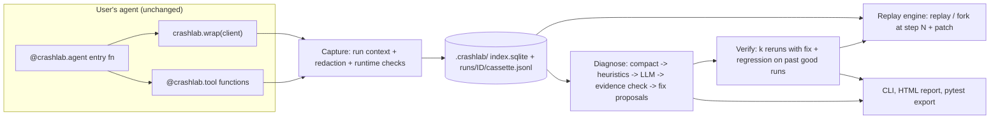

# crashlab architecture (v0.1)

**Crash-test your AI agents.** A local-first, framework-agnostic Python library that records an agent run, replays it exactly, diagnoses the failing step and its cause with verbatim evidence, verifies a proposed fix, and exports the failure as a pytest regression test.

Users keep their own agent loop. They only wrap their LLM client and decorate their tools.

## v0.1 scope (keep it tight)

- Providers: OpenAI and Anthropic clients (sync + async), LiteLLM via patch. No streaming replay beyond assembled responses.
- Failure labels (6 + UNKNOWN): `TOOL_ERROR_MISHANDLED`, `BAD_TOOL_ARGUMENTS`, `WRONG_TOOL_SELECTION`, `STEP_REPETITION`, `TASK_SPEC_VIOLATION`, `EXTERNAL_FAILURE`, `UNKNOWN`.
- Fault types for the seed benchmark (4): HTML/garbage tool result, persistent tool error, ambiguous tool descriptions, removed system-prompt constraint. Plus clean runs for false positives.
- Demo agents (2): `refund_bot` (order DB + refund tool + policy), `sql_analyst` (SQLite schema/query tools).
- Deferred: MCP proxy, LangGraph adapter, memory correction, auto-apply fixes, hosted version, web app.

## Data flow



## Modules (build in this order)

| # | Module | Responsibility |
|---|---|---|
| 1 | `models.py` | Pydantic v2: `Run`, `Step`, `Flag`, `Patch`, `Diagnosis`, `Evidence`, `Fix`, `Verification` |
| 2 | `context.py` | `contextvars` current run, monotonic step counter, mode (`record` / `replay` / `fork`) |
| 3 | `store/` | `sqlite.py` index (runs, steps metadata, flags, diagnoses), `cassette.py` JSONL read/write, `redact.py` strips keys/headers + user regex hook |
| 4 | `capture/` | `normalize.py` (provider -> common request/response shape + request hash), `openai.py`, `anthropic.py`, `litellm.py` proxies, `_chat.py` (single LLM-call interception point), `streams.py` (pass-through stream wrappers + assemblers), `tools.py` (`@tool(side_effects=...)`), `agent.py` (`@agent`, `record()` context manager); `integrations/litellm.py` exposes `patch()` / `unpatch()` |
| 5 | `cli.py` | Typer + Rich: `ls`, `show` first; later `replay`, `fork`, `diagnose`, `verify`, `export-test`, `report`, `bench` |
| 6 | `replay/` | `engine.py` (strict replay; fork = cassette for steps < N, patch at N, live after), `patches.py` (`SystemPrompt`, `ToolDescription`, `ToolResult`, `InjectMessage`, `Model`), `divergence.py` (hash mismatch -> `DivergenceError` with diff) |
| 7 | `checks/` | Inline flags: `loop` (same tool+args >= 3 in last 8 steps), `tool_error_streak` (>= 3), `bad_tool_args`, `suspicious_tool_result` (HTML/empty where JSON expected), `budget`, `length_cutoff` |
| 8 | `diagnose/` | `compact.py` step table with truncation handles, `heuristics.py` candidate steps from flags/errors, `diagnoser.py` one LLM call returning JSON (failing_step, label, evidence, explanation, confidence), `evidence.py` drops quotes not found verbatim -> UNKNOWN if none, `fixes.py` separate LLM call producing 1-3 typed fixes, `taxonomy.py` enum + definitions |
| 9 | `verify/` | `runner.py` k forks with fix + reruns of past passing runs, `oracles.py` (`@check` fns > "same failure didn't recur" > LLM judge, labelled weaker), `stats.py` pass^k + Wilson CI + verdict |
| 10 | `export/` + `pytest_plugin.py` | Write `tests/crashlab/test_<agent>_<id>.py` + copied cassette; plugin adds `crashlab_replay` fixture and `--crashlab-live` |
| 11 | `report/` | Single-file HTML report (Jinja2): timeline, failing step, evidence, fix diff, verification table |
| 12 | `bench/` | Fault injectors, seed runs, metrics: step localization (exact / within window), label accuracy, fix success, false positive rate, cost |

## Capture details (as built)

- **Common shape.** Every provider maps to `{"system", "messages", "tools", "params"}` requests
  and `{"messages", "tool_calls", "finish_reason", "usage", ...}` responses. Messages carry
  typed `parts` (`text`, `tool_call`, `tool_call_response`, `image`/`audio`/`file`
  placeholders, `reasoning`), loosely following the OTel `gen_ai.input.messages` schema.
  Tool-call arguments are stored parsed (invalid JSON stays a raw string). Anthropic
  `tool_result` blocks become `tool` messages, so OpenAI and Anthropic runs line up.
- **Request hash.** sha256 of canonical JSON (sorted keys) of the redacted normalized
  request. Transport-only kwargs (headers, timeouts, `stream`, API keys) are excluded, so a
  streamed and a plain call with the same inputs hash the same.
- **One interception point.** All LLM calls go through `capture/_chat.invoke()`; replay
  will substitute cassette responses there.
- **Streaming.** Streams are wrapped, not consumed: chunks pass through unchanged and the
  assembled final response is recorded on end / error / close (`crashlab.stream.complete`).
- **OpenAI-compatible quirks.** `reasoning` / `reasoning_content` on assistant messages and
  stream deltas (Groq, DeepSeek, vLLM, LiteLLM) become `reasoning` parts. `finish_reason`
  `"stop"` on a turn that has tool calls (Gemini streams) normalizes to `"tool_calls"`; the raw
  value stays in `provider_finish_reason`. The provider's `total_tokens` is kept
  (`crashlab.usage.total_tokens`) and summed into the run total, because it can exceed
  input+output (Gemini thinking tokens).
- **Opaque tokens survive.** Media elision only touches `data:` URLs and base64 under media
  keys (`data`, `b64_json`, `file_data`...). Replay tokens such as Gemini `thought_signature`,
  Anthropic `signature` / `redacted_thinking`, and OpenAI `encrypted_content` are stored
  verbatim, since the provider needs them back.
- **Threads.** Context vars do not cross plain threads; `crashlab.bind_context`,
  `ContextThreadPoolExecutor` and `run_in_thread` carry the active run into workers.

## Key design rules

1. Never record secrets. Redact before writing.
2. Tools marked `side_effects=True` never run live during replay or fork; they return the recorded result or a stub that raises.
3. Fixes are suggestions. Never auto-apply to user code.
4. Every diagnosis must cite verbatim evidence, or it says UNKNOWN.
5. Diagnosis and fix proposal are separate LLM calls.
6. Show estimated cost before verification; default k=3; early stop when the target fails twice.
7. Core installs with no provider SDKs; providers are extras (`crashlab[openai]`, `[anthropic]`, `[litellm]`).
8. No telemetry.

## Public API target

```python
import crashlab
from openai import OpenAI

client = crashlab.wrap(OpenAI())          # or anthropic.Anthropic(); LiteLLM: crashlab.integrations.litellm.patch()

@crashlab.tool()
def get_order(order_id: str) -> dict: ...

@crashlab.tool(side_effects=True)
def issue_refund(order_id: str, amount: float) -> dict: ...

@crashlab.agent(name="refund-bot")
def run_agent(user_msg: str) -> str: ...   # existing loop, unchanged

@crashlab.check("refund-bot")
def refund_not_above_total(run) -> bool: ...

run = crashlab.load("last")
crashlab.replay(run)                                    # offline, exact
d = crashlab.diagnose(run)                              # failing_step, label, evidence, fixes
v = crashlab.verify(run, fix=d.fixes[0], k=3)           # verdict, pass^k, CI
crashlab.export_test(run, fix=d.fixes[0])
```

```bash
crashlab ls --flagged
crashlab diagnose last
crashlab verify last --fix 1 -k 3
crashlab export-test last --fix 1 && pytest tests/crashlab -q
crashlab report last --open
```

## Repo layout

```
src/crashlab/{__init__,models,context,cli,pytest_plugin}.py
src/crashlab/{store,capture,integrations,checks,replay,diagnose,verify,export,report}/
examples/{refund_bot,sql_analyst}/
bench/{faults.py,run_bench.py,results/}
tests/
.github/workflows/{ci.yml,release.yml}
pyproject.toml  LICENSE  README.md  ARCHITECTURE.md
```

## Stack

Python >= 3.10, Pydantic v2, stdlib sqlite3, Typer + Rich, Jinja2, hatchling, uv, ruff, pytest + pytest-asyncio, GitHub Actions (3.10 to 3.13), PyPI Trusted Publishing, Apache-2.0.
