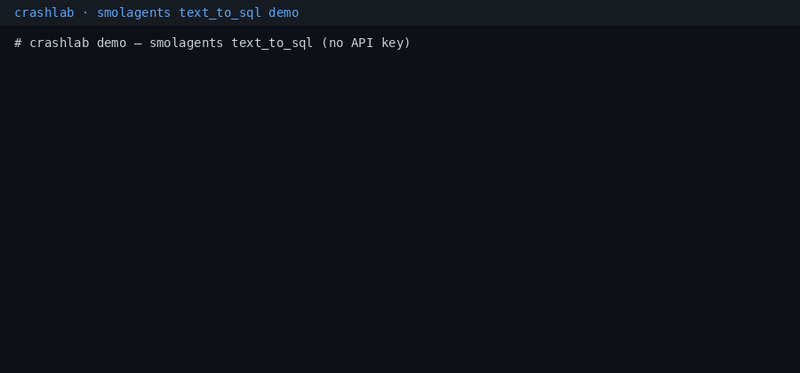

# crashlab

[](https://github.com/Mpasha17/crashlab/actions/workflows/ci.yml)
[](LICENSE)
[](pyproject.toml)

**Crash-test your AI agents.** Your agent failed in production. crashlab replays the exact
run offline, tells you which step broke and why, and checks whether a fix works before you
ship it.

crashlab is an open-source, framework-agnostic Python library that turns agent failures into fixes you can trust. It works today:

- **Record** every LLM and tool call from your existing agent loop (OpenAI, Anthropic, LiteLLM), with no rewrite.
- **Replay** any failed run exactly, offline, and fork it at any step.
- **Diagnose** the failing step and its root cause, backed by verbatim evidence from the trace.
- **Verify** a proposed fix by rerunning the failure and your past good runs.
- **Export** the failure as a pytest regression test.



```bash
pip install "crashlab[openai] @ git+https://github.com/Mpasha17/crashlab"   # not on PyPI yet
```

Then try it [offline with no API key](#try-it-with-no-api-key-and-no-model) or see the
[Quickstart](#quickstart).

> **Status: pre-alpha (0.0.1).** Today crashlab **records** runs, lets you inspect them,
> **replays** them strictly offline, grades them with **`@crashlab.check`** oracles,
> **forks** them at any step with typed **patches** and **diffs** two runs. It also
> **diagnoses** failed runs, **proposes fixes** and **verifies** them with repeated live
> forks, then **exports** a pytest regression test and a shareable HTML report (see
> [ARCHITECTURE.md](ARCHITECTURE.md)). Not on PyPI yet.

## Reproduced a real upstream bug

We pointed crashlab at well-known open-source agent examples, with oracles from their
documented behaviour — no injected faults.

**Flagship: [huggingface/smolagents](https://github.com/huggingface/smolagents)
`examples/text_to_sql.py`.** This is a known, still-unmerged bug with an open fix PR
([#2475](https://github.com/huggingface/smolagents/pull/2475), opened 8 Jul 2026 by xiangyuhao723); crashlab reproduced and
diagnosed it independently. The example builds `sqlite:///:memory:`, then
`LocalPythonExecutor` runs every code block in a fresh `ThreadPoolExecutor`.
SQLAlchemy's default `SingletonThreadPool` for `:memory:` opens a new, **empty**
database in that thread, so the agent hits `no such table: receipts` and invents a
failure. Direct calls on the main thread work, which hides the bug. crashlab adds a
no-LLM repro through smolagents' own `LocalPythonExecutor`: upstream → error,
`StaticPool` + `check_same_thread=False` → `('Woodrow Wilson',)`.

Case studies: [docs/case-studies/](docs/case-studies/README.md). Flagship write-up: [smolagents text_to_sql](docs/case-studies/smolagents-text-to-sql.md).
Terminal demo (no keys): [docs/demo/](docs/demo/README.md) (GIF above). We did **not** file an
upstream issue: it would duplicate PR #2475.

Also tried: OpenAI Agents SDK `examples/customer_service` (Triage Agent answers
follow-up FAQ questions itself on a smaller open model; two scoped prompt patches were
correctly **REJECTED** by `crashlab verify` for regressing past FAQ runs — the rejection
is the point). CrewAI: recording gap on `with_raw_response.create` fixed; 3/3 live
scenarios pass. Integration notes: [examples/integrations/](examples/integrations/).

## Results so far

Live runs of the bundled demo refund agent with injected faults, on free tiers. Each
fix was checked by `crashlab verify`: patched forks vs unpatched controls, plus past good
runs as a regression check. Small n; the labels are deliberately conservative.

| fault in the demo agent | model | verdict |
|---|---|---|
| `policy_drop`: the 30-day refund-window rule is missing from the system prompt | Groq gpt-oss-120b | **VERIFIED**: patched 5/5 vs control 0/5, 2/2 past good runs still pass, $0.002 |
| `policy_drop` (same restore-policy patch) | Groq gpt-oss-20b, Gemini flash-lite | **VERIFIED**: 3/3 vs control 0/3 on each |
| `misleading_desc`: the tool description says to refund `total * 0.9` | Groq gpt-oss-20b, Gemini flash-lite | **VERIFIED**: 3/3 vs control 0/3, regression run passes (gpt-oss-120b: INCONCLUSIVE, rate-limited) |
| `html_502`: `get_order` returns an HTML 502 page and the agent retries in a loop | Groq gpt-oss-120b | **LIKELY** only: 3/3 vs control 1/3 (intervals overlap) |

On a real, unmodified example (OpenAI Agents SDK `customer_service`), both prompt
patches for a genuine triage failure were **REJECTED** because they broke past good FAQ
runs. That is the verifier doing its job.

Evidence: [live scoreboard](docs/case-studies/worker-c-live-scoreboard.md),
[case studies](docs/case-studies/README.md), [Verify a fix](#verify-a-fix).

## What works today

- **`crashlab.wrap(client)`** records LLM calls, sync and async:
  - OpenAI `OpenAI` / `AsyncOpenAI` and any OpenAI-compatible endpoint (Ollama, vLLM,
    LiteLLM proxy ...): `chat.completions.create` and `responses.create`.
  - Anthropic `Anthropic` / `AsyncAnthropic`: `messages.create` and `messages.stream(...)`.
- **LiteLLM:** `crashlab.integrations.litellm.patch()` (or `crashlab.wrap(litellm)`) records
  `litellm.completion` / `litellm.acompletion`; `unpatch()` restores them.
- **Streaming:** with `stream=True` (and Anthropic's `messages.stream()`), chunks reach your
  code unchanged; crashlab assembles and records the final response when the stream ends,
  errors, or is closed early (marked incomplete).
- **One common shape** for every provider: system, messages as typed parts (text,
  tool calls, tool results, images/audio/files as placeholders, reasoning), tools, params,
  plus finish reason and token usage. The same conversation on OpenAI and Anthropic
  normalizes to the same messages, and each request gets a stable sha256 `request_hash`.
- **`@crashlab.tool(side_effects=...)`** records tool arguments, results and exceptions;
  **`@crashlab.agent(name=...)`** / **`with crashlab.record(name, input=...)`** mark runs
  (input, output, status, usage totals, entry point, git sha).
- **Threads:** `crashlab.bind_context(fn)`, `crashlab.ContextThreadPoolExecutor` and
  `crashlab.run_in_thread(fn, ...)` keep recording tool/LLM calls made in worker threads
  (asyncio tasks and `asyncio.to_thread` work out of the box).
- **Local store** `.crashlab/` (or `$CRASHLAB_DIR`): a SQLite index plus one JSONL cassette
  per run. API keys, auth headers (`Authorization`, `x-api-key` ...) and token-like strings
  are redacted before anything is written; add your own rules with
  `crashlab.redaction.add_pattern(...)`, `add_key(...)`, `add_hook(fn)`.
- **Strict offline replay:** `crashlab.replay(run)` / `crashlab replay <run_id|last>`
  re-runs the recorded entry point with every LLM and tool call served from the cassette:
  no API key, no network (outbound connections are blocked), and tools never run, so
  `side_effects=True` tools cannot fire. Calls are matched by step order plus the normalized
  request hash; anything else raises `DivergenceError` with the step, the differing fields
  and a diff. Works for OpenAI chat / Responses, Anthropic (`messages.stream()` included) and
  LiteLLM, plain and streamed, sync and async. The replay is stored as a new run with
  `replay_of` pointing at the source.
- **Outcome oracles:** `@crashlab.check("agent-name")` functions get the finished run and
  pass (return `True` / `None`) or fail (`False`, a message string, or a failed `assert`).
  They run when a run ends and set `outcome` to `pass` / `fail`;
  `crashlab check <run_id>` re-runs them on a stored run.
- **Fork at step N with a patch:** `crashlab.fork(run, at_step=N, patch=...)` /
  `crashlab fork <run> --at N ...` re-runs the agent with steps before N served strictly from
  the cassette and step N onwards live (or against a client you pass), with the patch
  applied to every LLM request from N on. Tool calls identical to the parent's are served
  from the cassette; `side_effects=True` tools never run live (an identical call gets the
  recorded result, anything else is blocked and recorded as an attempt). The fork is a new
  run linked by `forked_from`, `fork_step` and the patch.
- **Typed patches** (pydantic, JSON/YAML-serializable, composable with `+`, each renders a
  human-readable diff): `SystemPromptPatch` (replace / append / prepend / insert, replace
  or delete a line / substitute; optional `when` scopes to one agent's prompt), `MessagePatch`, `InjectMessagePatch`, `ToolResultPatch`
  (counterfactual tool result or error), `ToolDescriptionPatch`, `ToolSchemaPatch`,
  `ModelParamPatch` (model and params). Work for OpenAI chat / Responses, Anthropic and
  LiteLLM.
- **`crashlab diff A B`** / `crashlab.diff(a, b)`: how the runs relate (fork / replay),
  outcome and check changes, tokens / steps / time side by side, a step-by-step comparison
  (same, different request, different response, only in A / B) and the first divergence
  with a field diff. `B` defaults to `A`'s parent.
- **Runtime checks** (built in, on by default): cheap deterministic detectors that run
  while the agent is recorded and on stored runs (`crashlab check`). They emit typed
  findings (kind, severity `info` / `warn` / `error` / `critical`, steps, a message and
  verbatim evidence quotes):
  `step_repetition` (same tool + arguments again and again, near-identical LLM requests),
  `tool_error_streak`, `bad_tool_args` (validated against the tool's JSON schema),
  `suspicious_tool_result` (HTML / error pages, empty or truncated results, a result whose
  shape drifted from earlier results of the same tool), `budget` (steps, LLM / tool calls,
  tokens, USD, seconds) and `length_cutoff`. Findings are stored with the run and shown by
  `show`, `diff` and `ls --flagged`. They describe *how* a run behaved; `@crashlab.check`
  oracles still decide whether it passed. Opt-in **circuit breaker**: a critical finding
  stops the agent (`CircuitBreakerError`), and strict replay stops at the same step.
- **Cost estimates** per step and per run in USD, from a small built-in price table
  (OpenAI, Anthropic, Groq, Gemini; dated prices) plus LiteLLM's cost map when LiteLLM is
  installed. Local servers (Ollama, localhost) cost $0. Unknown models show no cost; prices
  are never guessed. Your own prices: `crashlab.pricing.set_price(...)` or
  `[tool.crashlab.prices]`.
- **Diagnose:** `crashlab diagnose RUN` / `crashlab.diagnose(run, model=...)` names the
  failing step, a failure label (`TOOL_ERROR_MISHANDLED`, `BAD_TOOL_ARGUMENTS`,
  `WRONG_TOOL_SELECTION`, `STEP_REPETITION`, `TASK_SPEC_VIOLATION`, `EXTERNAL_FAILURE`, or
  `NO_FAILURE` / `UNKNOWN`), a one-sentence root cause and verbatim evidence quotes, from
  one LLM call over a compacted trace with the checks and findings as hints. Every quote
  is checked against the step it cites; an answer without valid evidence becomes
  `UNKNOWN`. Any model works (Groq, Gemini, Ollama, OpenAI, Anthropic, LiteLLM);
  `--heuristic` needs none. Stored with the run, shown by `crashlab show`, cached.
- **Fix proposals:** `crashlab fix RUN` / `crashlab.propose_fixes(run)` makes a second,
  separate LLM call that turns the diagnosis into 1-3 ranked typed patches (system prompt
  line, tool description or schema, model params, a message; tool-result counterfactuals
  are marked test-only), each with a rationale and expected effect. A proposal is kept
  only if it parses, its target exists in the run (dry-run diff), it is small, and it does
  not hard-code this run's data (order ids, amounts ...). Kept fixes are stored with the
  run and saved as patch files for `crashlab fork --patch`; `--try` forks once with the
  top fix and shows the checks.
- **`crashlab report RUN`:** one screen with the outcome, checks, findings, diagnosis,
  fixes with diffs and the next commands to run (`crashlab diagnose --fix` prints it too).
- **Share runs:** `crashlab export RUN -o run.jsonl` / `crashlab import run.jsonl`
  (redacted again on the way out).
- **CLI:** `crashlab ls`, `crashlab show <run_id|last>`, `crashlab replay`, `crashlab check`,
  `crashlab diagnose`, `crashlab fix`, `crashlab report`, `crashlab fork`, `crashlab diff`, `crashlab export`, `crashlab import`; in Python,
  `crashlab.load("last")`.

Not yet: a live HTML viewer server. Streamed calls replay as a synthetic stream rebuilt from the recorded
final response (same content, different chunk boundaries).
Also not intercepted yet: Anthropic `client.beta.messages`, OpenAI
`chat.completions.stream()` / `responses.stream()` helpers. OpenAI
`chat.completions.with_raw_response.create` **is** recorded (CrewAI path).
OpenAI streams only report token usage if you pass `stream_options={"include_usage": True}`.

## Quickstart

```bash
pip install "crashlab[openai] @ git+https://github.com/Mpasha17/crashlab"
# or crashlab[anthropic], crashlab[litellm]
```

```python
import crashlab
from openai import OpenAI

client = crashlab.wrap(OpenAI())          # or OpenAI(base_url="http://localhost:11434/v1", api_key="ollama")
# client = crashlab.wrap(anthropic.Anthropic())

@crashlab.tool()
def get_order(order_id: str) -> dict: ...

@crashlab.tool(side_effects=True)
def issue_refund(order_id: str, amount: float) -> dict: ...

@crashlab.agent(name="refund-bot")
def run_agent(user_msg: str) -> str:
    ...                                    # your existing tool-calling loop, unchanged

@crashlab.check("refund-bot")              # outcome oracle: pass / fail
def refund_not_above_total(run) -> None:
    for step in run.tool_calls("issue_refund", ok_only=True):
        assert step.args["amount"] <= 49.0, f"refunded {step.args['amount']}"

run_agent("Refund my order A17, it arrived broken")

run = crashlab.load("last")                # Run with .steps (chat / execute_tool), .outcome
replayed = crashlab.replay(run)            # offline; raises DivergenceError if it differs

# what if the prompt had said so? fork at the first LLM call with a patch, run live
branch = crashlab.fork(run, at_step=0, patch=crashlab.SystemPromptPatch(
    op="append", text="Never refund more than the order total."))
print(crashlab.diff(run, branch).summary())
```

```bash
crashlab ls            # runs: id, name, status, outcome, steps, tokens, cost, findings
crashlab ls --flagged  # only runs with runtime-check findings (--min-severity error)
crashlab show last     # checks, findings + step table: idx, op, name, args / result, error
crashlab replay last   # offline re-run from the cassette; exit 1 + diff on divergence
crashlab check last    # re-run the oracles and the runtime checks (--save to store them)
crashlab check --all --findings-only --max-cost 0.05 --fail-on error   # e.g. in CI
crashlab fork last --at 0 --system-append "Never refund more than the order total."
crashlab fork last --at 2 --patch fix.yaml --dry-run   # show the patch diff, run nothing
crashlab diff last     # the fork vs its parent: checks, usage, steps, first divergence
```

Runtime checks are configured per run or in `pyproject.toml`, and `record(checks=...)`
wins over pyproject:

```python
@crashlab.agent(name="refund-bot", checks={"max_steps": 20, "max_cost_usd": 0.10,
                                           "circuit_breaker": True})
```

```toml
[tool.crashlab.checks]
circuit_breaker = true          # stop the agent on a critical finding (default: off)
max_steps = 20                  # budget: also max_llm_calls, max_tool_calls, max_tokens,
max_cost_usd = 0.10             #   max_seconds; warn at 80% (budget.warn_at)
[tool.crashlab.checks.step_repetition]
threshold = 3                   # warn at 3 identical tool calls, critical at 5
```

### Try it with no API key and no model

The repo ships five real recorded runs of the demo agent (secrets and local paths scrubbed):
a clean refund, a policy violation the oracles fail, a 502 retry loop the runtime checks
flag, a run the circuit breaker stopped, and a small local model passing a bad argument.

```bash
git clone https://github.com/Mpasha17/crashlab && cd crashlab
python -m venv .venv && . .venv/bin/activate && pip install -e ".[openai]"
export CRASHLAB_DIR=/tmp/crashlab-demo
for f in examples/refund_bot/demo/*.jsonl; do crashlab import "$f"; done
crashlab ls                        # 5 runs, with cost and findings
crashlab show 01M57GM9Q5           # Groq gpt-oss-120b retrying an HTML 502 page 3 times
crashlab check --all               # oracles + runtime checks, offline (exit 1: C03 fails)
crashlab replay 01M57GM7H9         # strict offline replay of the policy violation
crashlab diagnose 01M57GM7H9 --heuristic   # failing step + label from checks/findings
crashlab fork 01M57GM7H9 --at 0 --dry-run \
  --system-append "Never refund an order delivered more than 30 days ago."
```

### Diagnose a run

```bash
# any OpenAI-compatible endpoint; the key is read from the env var you name
crashlab diagnose 01M57GM7H9 --model openai/gpt-oss-120b \
  --base-url https://api.groq.com/openai/v1 --api-key-env GROQ_API_KEY
crashlab diagnose last --model gemini/gemini-flash-latest      # via LiteLLM
crashlab diagnose last --model qwen2.5:7b --base-url http://localhost:11434/v1  # Ollama
crashlab diagnose last --show-prompt   # the compacted trace the diagnoser reads, no call
```

```python
d = crashlab.diagnose(run, model="openai/gpt-oss-120b",
                      base_url="https://api.groq.com/openai/v1", api_key=key)
d.label, d.failing_step, d.root_cause, d.evidence   # also run.diagnosis, `crashlab show`
```

Or set `CRASHLAB_DIAGNOSER_MODEL` / `CRASHLAB_DIAGNOSER_BASE_URL` /
`CRASHLAB_DIAGNOSER_API_KEY`. The diagnoser's own calls are recorded in
`.crashlab/diagnoser/`, apart from your runs.

On 31 hand-labelled live runs of the demo agent (`bench/diagnose_eval.py`, details in
[bench/README.md](bench/README.md)), with prompt v3 Groq `openai/gpt-oss-120b` gets the label
right on 90% and Gemini `gemini-flash-lite-latest` on 87% (heuristic baseline: 81%, tuned on
the same set); exact culprit step on 71% / 76% of the failing runs, with no false alarms
on clean runs.

### Propose a fix and try it

```bash
crashlab fix 01M57GM7H9 --model openai/gpt-oss-120b \
  --base-url https://api.groq.com/openai/v1 --api-key-env GROQ_API_KEY
crashlab report 01M57GM7H9          # diagnosis, fix-1 with its diff, next commands
# --try forks once with fix-1, live: the agent uses its own client, e.g. on Groq
OPENAI_BASE_URL=https://api.groq.com/openai/v1 OPENAI_API_KEY=$GROQ_API_KEY \
  crashlab fix 01M57GM7H9 --model openai/gpt-oss-120b \
  --base-url https://api.groq.com/openai/v1 --api-key-env GROQ_API_KEY --try
```

### Verify a fix

```bash
# 5 forks with fix-1 + 5 unpatched controls + the patch rerun on past good runs
OPENAI_BASE_URL=https://api.groq.com/openai/v1 OPENAI_API_KEY=$GROQ_API_KEY \
  crashlab verify 01M57GM7H9 --fix fix-1 -k 5 --regress 01M57GM0VB,01M57GM5RH --max-cost 0.50
# or all in one: diagnose (if needed) -> fix -> verify
crashlab fix 01M57GM7H9 --model ... --verify -k 5
```

Verdicts: **VERIFIED** (patched Wilson 95% lower bound above the control's upper bound,
or controls all fail and patched all pass; no regression), **LIKELY** (better, but not
significant or incomplete), **INCONCLUSIVE** (too few usable trials), **REJECTED** (a
past good run now fails, or no better than control). Provider errors (429/5xx) are
counted as `errored`, never as fails. `--no-control`, `--regress none|tag:X|ID,ID`,
`--json`, `--pace SECONDS` (free-tier rate limits). Child runs are tagged `verify:<id>`; `crashlab report` lists fix attempts.
On Groq gpt-oss-120b: policy_drop fix-1 went 5/5 vs control 0/5, 2/2 good runs still
pass (VERIFIED, $0.002).

### Export a regression test and an HTML report

```bash
crashlab export-test 01M5GTK1FR --fix auto -o tests/crashlab   # test + cassettes
pytest --crashlab            # runs only exported tests: offline, no keys, no network
crashlab report 01M5GTK1FR --html report.html   # one self-contained file to share
```

The exported test replays the failing run and asserts its `@check` results, and (with
`--fix`) replays a passing patched run from `crashlab verify` with the fix re-applied,
asserting it still passes. The pytest plugin (auto-loaded) adds `--crashlab`, the
`@pytest.mark.crashlab` marker and the `crashlab_replay(path)` / `crashlab_store`
fixtures. Store and home paths are replaced in exported cassettes. See
[examples/refund_bot/tests](examples/refund_bot/tests), which CI runs.
The HTML report has the outcome, checks, findings, diagnosis with quotes, fixes with
diffs, verification stats and the step timeline; inline CSS, no scripts, no external
assets.

### Free, local, with Ollama

Running the demo agent, or a fork for real (without `--dry-run`), needs a model. A local
one is free:

```bash
ollama pull qwen2.5:3b             # or llama3.2:3b / qwen2.5:7b: any tool-calling model
OPENAI_BASE_URL=http://localhost:11434/v1 OPENAI_API_KEY=ollama MODEL=qwen2.5:3b \
  python -m examples.refund_bot "Refund my order A17, it arrived broken"
FAULT_HTML_502=1 OPENAI_BASE_URL=http://localhost:11434/v1 OPENAI_API_KEY=ollama MODEL=qwen2.5:3b \
  python -m examples.refund_bot "Refund my order A17"     # get_order returns an HTML 502 page
# or through LiteLLM (pip install -e ".[litellm]"): ollama_chat/ uses Ollama's native tools
python -m examples.refund_bot --provider litellm --model ollama_chat/qwen2.5:3b "Refund A17"
crashlab ls && crashlab show last  # cost: $0
crashlab replay last               # no model server needed

# the same agent on Anthropic
PROVIDER=anthropic ANTHROPIC_API_KEY=sk-ant-... MODEL=claude-haiku-4-5 \
  python -m examples.refund_bot "Refund my order A17, it arrived broken"
```

See [examples/refund_bot](examples/refund_bot/README.md) for details.

See [CHANGELOG.md](CHANGELOG.md) for what landed in 0.0.1.

## Benchmark (seed, small n)

`crashlab bench` injects 4 faults into 2 demo agents (3 episodes per cell, fixes verified
with k=3) and scores the diagnoser on a held-out agent (`sql-analyst`) that nothing was
tuned on. On Gemini flash-lite, the LLM diagnoser labelled **6/6 triggered faults
correctly (Wilson 95% CI 61–100%)**; the heuristic baseline got 2/6 (10–70%). No fix was
VERIFIED on the held-out agent (0/3, 1/3 LIKELY): its faults were in the tool and the
database, which a prompt patch can't repair, so the rejections are correct. On Groq
gpt-oss-120b the LLM diagnoser labelled only **3/11 (10–57%)** on the held-out agent.
Samples are small and the intervals are wide; details, all CIs and caveats in
[bench/README.md](bench/README.md#seed-results).

## Development

```bash
python -m venv .venv && . .venv/bin/activate
pip install -e ".[dev,openai,anthropic,litellm]"
ruff check . && ruff format --check . && pytest
```

The tests use fake clients and the real SDKs over mocked HTTP transports (LiteLLM via
`mock_response`), so they need no network access and no API key. Tests for SDKs that are
not installed are skipped.

Security notes: [SECURITY.md](SECURITY.md).

## License

Apache-2.0
